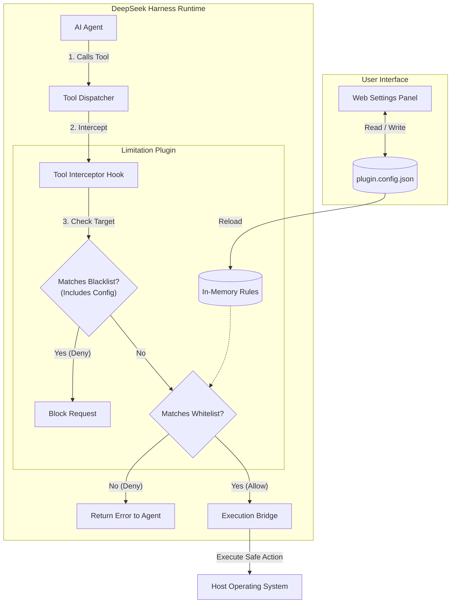

# Project Plan: Plugin for Agent Tool Use Limitation
> **Course:** Contemporary Issues in Software Engineering  
> **Status:** Planning Stage (Pre-implementation, no code written yet)  

---

## 1. Prioritised Backlog for Two Short Iterations

### 1.1 Iteration 1: Core Security Engine (Days 1–7)
* **Goal:** Intercept DSH tool calls and block unauthorized commands using a default-deny whitelist without crashing DSH.

| ID | Item | Priority | Estimate | Testable Acceptance Criteria | Assignee |
| :--- | :--- | :---: | :---: | :--- | :--- |
| **PB-01** | **Tool Interception Hook** | P0 (Must) | 3d | **Given** an agent calls `run_command`, **When** DSH processes the call, **Then** the plugin intercepts it before execution and returns an allow or deny result. | Liu Jiazhuang (Dev) |
| **PB-02** | **Target Blacklist & Self-Protection** | P1 (Should) | 2d | **Given** a blacklist protecting `plugin.config.json` by default plus custom forbidden targets, **When** an agent tries to access or modify a blacklisted target, **Then** the plugin immediately blocks it. | Liu Jiazhuang (Dev) |
| **PB-03** | **Test Suite** | P1 (Should) | 2d | **Given** 10 safe and 10 malicious test commands, **When** run on Mac/Linux and Windows, **Then** 100% of malicious commands are blocked. | Chen Cheng (QA) |

---

### 1.2 Iteration 2: Web GUI & System Hardening (Days 8–14)
* **Goal:** Add a visual configuration UI in DSH and verify that tool limits cannot be bypassed by an autonomous agent.

| ID | Item | Priority | Estimate | Testable Acceptance Criteria | Assignee |
| :--- | :--- | :---: | :---: | :--- | :--- |
| **PB-04** | **Web GUI Integration** | P0 (Must) | 3d | **Given** the user opens DSH in a browser, **When** clicking the tool limitation plugin tab, **Then** a settings panel renders correctly. | Zhang Bochen (UI) |
| **PB-05** | **Rule Editor & Reloading** | P0 (Must) | 2d | **Given** the user adds a new whitelist rule in the GUI, **When** clicking "Save", **Then** the rule saves to disk and takes effect immediately without restarting DSH. | Zhang Bochen (UI) |
| **PB-06** | **Agent Adversarial Testing** | P1 (Should) | 2d | **Given** an agent prompted to bypass rules, **When** it attempts tricks (subshells, alias injection), **Then** the plugin blocks them and logs the attempt. | Chen Cheng (QA) |
| **PB-07** | **User Documentation & Guide** | P1 (Should) | 2d | **Given** a new user installing the plugin, **When** following the setup guide, **Then** they can successfully configure their first rule within 10 minutes. | Zhang Jinyuan (PM) |

---

## 2. Team Roles and Responsibilities

* **Project Manager (PM) / Scrum Master — Zhang Jinyuan:** Manages sprint backlogs, tracks progress, coordinates risk mitigations, and leads project documentation.
* **Core Developer — Liu Jiazhuang:** Builds DSH hooks, whitelist/blacklist logic, in-memory caching, and self-protection security.
* **UI Developer — Zhang Bochen:** Builds the Web GUI panel, rule management forms, and settings persistence.
* **QA Lead — Chen Cheng:** Sets up Windows and Unix test environments, writes test suites, and performs red-team security tests.

### RACI Matrix:
| Task / Deliverable | Zhang Jinyuan (PM) | Liu Jiazhuang (Dev) | Zhang Bochen (UI) | Chen Cheng (QA) |
| :--- | :---: | :---: | :---: | :---: |
| Sprint Backlog & Risk Tracking | **Accountable** | Informed | Informed | Informed |
| DSH Hooking & Interception | Informed | **Accountable** | Informed | Consulted |
| Web Configuration GUI | Informed | Supported | **Accountable** | Consulted |
| Target Blacklist & Self-Protection | Informed | **Accountable** | Informed | Supported |
| Adversarial & System Testing | Informed | Supported | Supported | **Accountable** |
| User Guide & Final Presentation | **Accountable** | Supported | Supported | Supported |

---

## 3. Key Risks and Management Strategies

| Risk | Likelihood | Impact | Mitigation Strategy | Owner |
| :--- | :---: | :---: | :--- | :--- |
| **1. Agent Modifies Config (Self-Tampering)** The agent uses file tools to edit `plugin.config.json` and remove its own limits. | Medium | High | **Default Blacklist:** A configurable target blacklist that permanently includes `plugin.config.json` by default to block any modification attempts. | Liu Jiazhuang (Dev) |
| **2. Cross-Platform Command Differences** Windows and Unix use different shells (PowerShell vs bash) and distinct commands/parameters. | High | High | **Platform Profiles:** Allow users to define platform-specific whitelist rules (e.g., separate presets for Windows and Unix). | Zhang Bochen (UI) |
| **3. Testing Takes Too Long** Manual testing on multiple operating systems delays the 2-week deadline. | High | Medium | **Automated CI:** Run automated headless test scripts on Windows and Linux runners on every commit. | Chen Cheng (QA) |

---

## 4. System Overview Architecture

---

## 5. Major Design Decisions

### Decision 1: Dual Control Strategy (Whitelist + Blacklist)
* **Choice:** Combine a tool whitelist with a target blacklist (protecting `plugin.config.json` by default).
* **Role of Whitelist:** Controls what tools and commands the agent can run (blocks dangerous or unapproved commands by default).
* **Role of Blacklist:** Controls what files the agent cannot touch (blocks sensitive files and prevents the agent from modifying its own rules).

### Decision 2: Embedded Web GUI vs. Manual File Editing
* **Choice:** Provide an embedded Web GUI panel for rule management.
* **Why:** Avoids manual JSON syntax errors and makes rule configuration easier for users.
